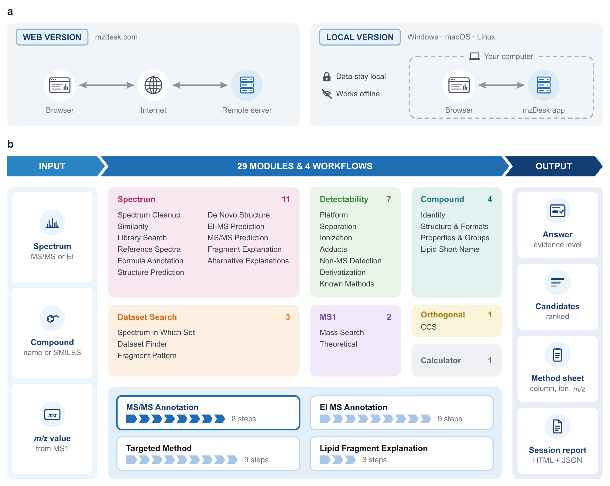

<p align="center"></p>

<h1 align="center">mzDesk</h1>

<p align="center"><a href="README.md">English</a> | <a href="README.zh-CN.md">简体中文</a> | <a href="README.ja.md">日本語</a> | <b>Deutsch</b> | <a href="README.fr.md">Français</a> | <a href="README.es.md">Español</a></p>

Werkzeuge für die Massenspektrometrie kleiner Moleküle, ganz ohne Programmieren. Der zentrale Workflow macht aus einem MS/MS-Spektrum eine Rangliste von Kandidatenstrukturen, jede mit einer Evidenzstufe.

- **Online:** [mzdesk.com](https://mzdesk.com), ohne Anmeldung
- **Lokal:** läuft offline unter Windows, macOS und Linux
- **Dokumentation:** [mzdesk.com/docs](https://mzdesk.com/docs)


## Lokale Version installieren

macOS und Linux:

```bash
curl -fsSL https://mzdesk.com/install.sh | sh
```

Windows (PowerShell):

```powershell
irm https://mzdesk.com/install.ps1 | iex
```

Keine Administratorrechte nötig. Danach starten:

```bash
mzdesk
```

Im Browser öffnet sich <http://localhost:8731>. Rechenmodule und Spektrenbibliotheken werden geladen, wenn eine Seite sie zum ersten Mal braucht (insgesamt etwa 9 GB). [Mehr zur Installation](https://mzdesk.com/docs/local-version)

## Funktionen



## Lizenz

[MIT](LICENSE). Mitgelieferte und heruntergeladene Werkzeuge behalten ihre eigenen Lizenzen: siehe [THIRD_PARTY_NOTICES.md](THIRD_PARTY_NOTICES.md).
