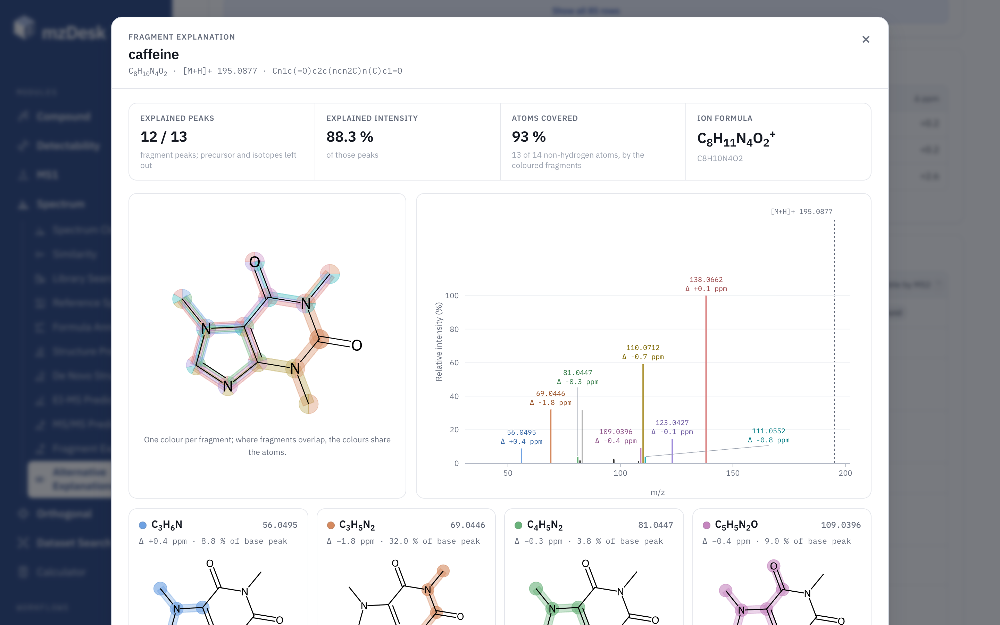

<p align="center"></p>

<h1 align="center">mzDesk</h1>

<p align="center"><a href="README.md">English</a> | <b>简体中文</b> | <a href="README.ja.md">日本語</a> | <a href="README.de.md">Deutsch</a> | <a href="README.fr.md">Français</a> | <a href="README.es.md">Español</a></p>

无需编程的小分子质谱工具。核心工作流把一张 MS/MS 谱图变成按可能性排序的候选结构，每个候选都带证据等级。

- **在线使用**：[mzdesk.com](https://mzdesk.com)，无需注册
- **本地使用**：可在 Windows、macOS 和 Linux 上离线运行
- **文档**：[mzdesk.com/docs](https://mzdesk.com/docs)



## 安装本地版

macOS 和 Linux：

```bash
curl -fsSL https://mzdesk.com/install.sh | sh
```

Windows（PowerShell）：

```powershell
irm https://mzdesk.com/install.ps1 | iex
```

不需要管理员权限。安装后启动：

```bash
mzdesk
```

浏览器会打开 <http://localhost:8731>。计算引擎和谱库在页面首次用到时自动下载（合计约 9 GB）。[安装详情](https://mzdesk.com/docs/local-version)

## 功能


## 许可证

[MIT](LICENSE)。随附和下载的第三方工具沿用各自的许可证，见 [THIRD_PARTY_NOTICES.md](THIRD_PARTY_NOTICES.md)。
